# Design and implementation notes

This describes the current source, not proposed features. The API has 30 explicit
method/path registrations across 19 canonical paths. See [Swagger UI](http://localhost:8080/swagger/index.html) and its [generated specification](swagger/swagger.yaml),
[ER diagram](erd.md), [requirements evidence](requirements-checklist.md), and
[validation results](validation.md).

## Architecture and request flow

`cmd/api` loads configuration, validates JWT settings, opens and pings a pgx pool,
constructs auth/tenant/user/RBAC services and handlers, and starts `net/http` with
Gin. Docker Compose runs PostgreSQL only: there is no API Compose service,
Dockerfile, automatic migration runner, or automatic seed/bootstrap at startup.

The normal flow is:

```mermaid
flowchart LR
    A[HTTP request] --> B[Request logger and panic recovery]
    B --> C[JWT middleware on protected groups]
    C --> D[Bounded request context]
    D --> E[Required action policy]
    E --> F[Handler: strict JSON or query parsing]
    F --> G[Service: validation and permission binding]
    G --> H[Repository: scoped pgx transaction]
    H --> I[Current actor and bound permission recheck]
    I --> J[Mutation plus audit or scoped read]
    J --> K[Commit and JSON response]
```

Operational probes and auth credential endpoints do not require an access JWT.
Auth endpoints use their own bounded context; login verifies credentials and
refresh/logout authenticate the supplied refresh credential. There is no public
registration or HTTP tenant creation, bootstrap, audit-query, global user-search,
or tenant-list endpoint. Unknown paths and unsupported methods use JSON 404/405
fallbacks; Gin trailing-slash redirects are separate from registered routes.

Packages follow handler → service → repository separation. `internal/access`
holds error mapping and scoped transaction primitives; `internal/httpapi` handles
shared body/error/pagination logic. The typed JWT identity key is private to
`internal/auth`. Database policies implement `access.Policy`, `TransactionPolicy`
and `TargetPolicy`; the application wires `rbac.NewPolicy`, not a permissive stub.
Tests may inject a policy to isolate older repository behavior; Phase 4 integration
HTTP tests use the real database policy.

## Configuration, connection pool and lifecycle

Optional `.env` loading uses `godotenv.Load`, never `Overload`. Existing process
environment variables, including empty values, take precedence. A missing file
is allowed; a malformed/unreadable file fails startup with a sanitized message.
Required settings are `DATABASE_URL` and a non-placeholder JWT secret with at
least 32 bytes after trimming surrounding whitespace. The application does not print configuration.

Default issuer is `multitenant-user-management`, access TTL 15 minutes, refresh
TTL 168 hours, DB pool maximum 10 connections, DB/request timeout 5 seconds and
shutdown timeout 10 seconds. Access TTL is constrained to 1 second–1 hour and
refresh TTL must exceed it. Database startup parsing/ping failures omit DSN and
driver details. `/health` reports liveness independently of subsequent DB state;
`/ready` does a bounded ping and returns 503 when it fails. Initial DB failure
prevents the API from starting.

SIGINT/SIGTERM stop accepting requests and drain HTTP before pool closure; an
expired shutdown deadline forces HTTP close. Server header/read/idle timeouts are
5/10/60 seconds; write timeout is DB timeout plus 10 seconds. bcrypt work itself
is not context-cancelable. This is a single-process foundation, not a deployment
or high-availability design.

## Tenant and identity isolation

Only verified JWT `sub` and `tenant_id` establish request identity. Tenant IDs in
headers, query parameters or body fields do not select scope. Unknown body fields
are rejected. User/role list query keys are allowlisted; some other handlers
ignore unknown query keys, but never use them to select a tenant.

Each scoped transaction locks the current tenant, rechecks active/non-deleted
actor and active, non-removed membership, then rechecks the bound permission in
the transaction. Target user reads join membership in that same tenant and
exclude soft-deleted users and removed relationships. Role queries always include
tenant scope. Authorized cross-tenant targets return 404. Authorization precedes
body validation/target lookup, so a caller without a grant receives 403 instead
of discovering target existence. Missing/invalid JWTs return 401.

Users and emails are global. Email uniqueness is the existing `LOWER(email)`
index, not uniqueness per tenant. Creation stores SQL `LOWER` after trimming;
login compares SQL `LOWER` on both operands. Soft deletion retains that uniqueness
reservation. Shared identity mutations/deletion return 409 while another live
membership exists; tenant-local membership changes remain available instead.
Attaching a known user UUID is an explicit privileged operation: the FK establishes
membership before the profile is read, and a missing/deleted target rolls back.

Membership removal sets `removed_at`, suspended status and a new version; it
retains membership, refresh and assignment history. Reattachment with historical
role assignments returns 409 rather than reviving dormant privileges. Suspended
target memberships may be managed, but their effective permission set is empty.
There is no automatic historical-grant review/recovery API.

## Authentication and refresh rotation

Passwords are checked with bcrypt. New/changed passwords require 12–72 UTF-8 bytes;
login accepts existing passwords of 1–72 bytes. DTOs never return hashes. Unknown
accounts use a dummy bcrypt comparison and the same 401 response as bad passwords,
wrong tenants and inactive accounts. This reduces enumeration signals, but does
not guarantee constant response timing across differing stored bcrypt costs.

Access tokens use HS256 and a configured secret. Claims are user ID (`sub`),
tenant ID, issuer, issued-at, expiry and a random JWT ID. Validation pins the
algorithm and issuer, requires expiry/issued-at/JWT ID and valid nonzero UUIDs,
rejects future issued-at and invalid lifetimes, and honors expiry/not-before.
No authority is inferred from role names or JWT role/administrator claims.

Refresh credentials are 32 random bytes encoded as unpadded base64url (43 chars).
Only their SHA-256 hex digests are persisted. Rotation opens a transaction,
selects the valid token with `FOR UPDATE`, locks validity rows, issues credentials,
rechecks expiry while revoking the old token, inserts its replacement and commits.
Concurrent reuse has one winner. Failed issuance/insertion rolls back revocation.
Commit failures return no usable response; a lost successful response cannot be
retried with the consumed credential. There is no token family/replay revocation
or retry/idempotency mechanism.

Logout authenticates and revokes only the submitted active refresh credential.
Repeated logout returns 401; other sessions and already issued access JWTs are
not revoked by logout. Role/permission changes affect the next protected request
without token renewal. Tenant suspension, membership suspension/removal, user
deletion and password changes revoke applicable refresh tokens; current DB checks
also block inactive identities using old access JWTs. Access JWT cryptographic
validity itself lasts until expiry; there is no JTI denylist or key-rotation API.

## RBAC and provisioning

The 20 exact supported `resource:action` pairs are listed in the README and Swagger specification.
Permissions are global identifiers; role/grant/assignment rows are tenant-specific.
Effective rights are the distinct union of all current-tenant roles. Composite
FKs enforce tenant-role relationships. Unsupported historical pairs remain stored
but are inert. No wildcard, permission cache or role-name bypass is implemented.

Policy queries use the membership PK, user-role PK/index, role tenant/ID uniqueness,
role-permission PK and permission resource/action uniqueness. They query current
state at the HTTP/service boundary and again inside locked transactions. This
adds DB round trips but avoids unreliable cache invalidation. There are no
performance or latency measurements in this submission.

Granting a permission requires both assignment authority and the granted right;
assigning a role requires every right on that role. Password changes and membership
activation require the actor to hold the target's assigned rights, including
dormant supported grants. These checks occur after the scoped target lookup and
inside the transaction, preventing indirect escalation by taking over a more
privileged identity or reactivating it. These are set-containment checks, not a
separate role hierarchy or object-ownership policy engine.

Tenant creation is an explicit operator CLI. Initial administrator bootstrap
requires both CLI opt-ins and a selected existing identity. Existing-tenant mode
requires active membership; new-tenant mode attaches the selected existing user.
All creation/grants/audits are one transaction, with nullable audit actor for the
operator. No account/password is created or reset. Existing roles/assignments or
an earlier bootstrap audit prevent repeating bootstrap, even after grant removal.
It is not a repair command. There is no last-administrator lockout protection or
HTTP recovery path for suspended tenants. Operators need a separately reviewed
procedure for production account provisioning, recovery and future catalog updates.

## Transactions, optimistic concurrency and errors

Management reads hold a shared tenant-row lock; management writes hold an exclusive
tenant-row lock. This serializes writes per tenant and coordinates revocation with
resource mutations. User row locks additionally coordinate cross-tenant attachment
and shared-profile safety. Direct SQL outside these workflows must respect their
invariants; there is no PostgreSQL row-level security policy protecting against
arbitrary direct queries using the application database role.

Tenant/user/membership writes compare client `expected_updated_at` against the
last response. Updated values strictly advance by at least one microsecond, even
if the wall clock has not advanced. Membership operations use the membership
timestamp, not the user's profile timestamp. Role profile versions are SHA-256
digests of ID/name/description; they detect representation changes, not every
intermediate change or permission history. Role PATCH replaces the profile.

Multi-table user creation, membership lifecycle, RBAC and refresh operations are
transactional. Role deletion removes only its tenant-scoped links/assignments and
audits those removals; global permission identifiers remain. PostgreSQL uniqueness,
FK and transaction conflicts map to 409, invalid values to 400, absent scoped rows
to 404. Request DB timeouts generally produce sanitized 500, not 504; readiness
uses 503. No automatic deadlock/serialization retry is implemented.

## Audit and logging

Management mutations and audits commit together; an audit failure rolls back the
change. Audits record action, actor/tenant/target UUIDs and related grant UUIDs,
not passwords, tokens, profile bodies or submitted email addresses. Login outcomes
are best effort in a separate bounded context that survives client cancellation;
audit failure emits a fixed warning. Failed/anonymous login has no authenticated
actor. Failed authorization attempts and refresh/logout are not audited as a
complete security-event stream. There is no audit search/export endpoint or
tamper-evident/external audit storage.

Request logs contain method, URL path, status and duration, omitting query strings,
bodies and authorization headers. Panic values and raw DB errors are not logged.
Arbitrary URL paths may still contain caller-supplied text; avoid putting secrets
in paths. JSON recovery cannot replace a response already written, and transport
errors generated by `net/http` need not use the application envelope.

## Security and operating limitations

- Compose's fixed credential and the public development seed password are for
  isolated local development only. The PostgreSQL port is loopback-bound. Do not
  reuse these accounts/credentials in production; configure credentials/TLS through
  a deployment-specific process. Secret placeholders and file ignoring are not a
  substitute for a real Git history audit or secret manager.
- The API defaults to `:8080`; use `127.0.0.1:8080` for local-only binding and an
  HTTPS reverse proxy for remote deployments. Trusted proxy lists are disabled.
  TLS termination, CORS policy, distributed rate limiting, lockout/MFA, email
  verification, password reset and production ingress configuration are absent.
- There is no last-admin protection, role inheritance, permission cache, token
  family replay defense, access-token logout invalidation, or automatic cleanup
  of expired refresh history. Add those only with explicit requirements and tests.
- Offset pagination is bounded and deterministic, but large offsets and substring
  search can be expensive. No query plans, load benchmarks, capacity limits or
  race-freedom claims are established by the current tests.
- Database roles are not least-privilege separated for migrations versus runtime;
  backups, disaster recovery, deployment hardening and data retention need an
  operational plan. Original SQL migrations are preserved, not rewritten.

These limitations are recorded in [the checklist](requirements-checklist.md) and
[actual validation results](validation.md), rather than represented as implemented
endpoints or production guarantees.

## Interactive API documentation

Swaggo annotations on the 30 handlers and their wire models generate Swagger 2.0
artifacts under `docs/swagger`. The imported generated Go package embeds the
specification. `server.NewSwagger` serves local swaggerFiles assets and JSON through
gin-swagger at `/swagger/*any`; these documentation URLs are excluded from API
route counts. They do not alter application authentication or permission checks.

Configuration defaults to production with documentation disabled. Only
`APP_ENV=development` enables it by default; an explicit `SWAGGER_ENABLED` boolean
overrides that decision. Invalid environments/booleans fail startup. If enabled
outside development, operators must restrict its exposure. The Authorize button
sends a complete `Bearer <JWT>` value in the Authorization header; no authorization
is persisted by Swagger UI. Refresh tokens remain JSON body credentials. Same-origin
URLs and bundled assets avoid a separate documentation host or external validator.
Try-it-out actions have real business/audit effects; documentation verification
uses only probes and static documentation GETs. No audit query endpoint is invented.

Go contract tests compare all registered application paths/methods, security,
permission metadata and 23 wire DTO field sets with generated JSON, plus embedded
JSON consistency and enabled/disabled UI/assets behavior. Generation is explicit;
annotations must be regenerated and the binary rebuilt after changes.
