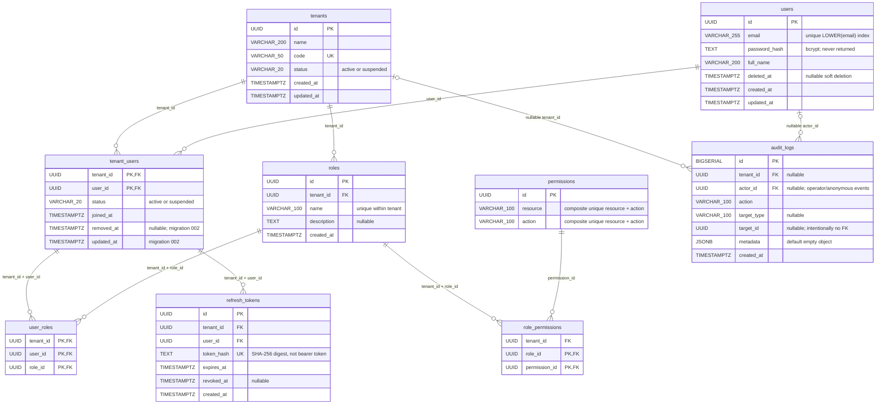

# Database ER diagram

Source of truth: [001_init.sql](../migrations/001_init.sql) and
[002_membership_lifecycle.sql](../migrations/002_membership_lifecycle.sql).
There are **nine tables**. The diagram shows actual foreign keys; HTTP target IDs
and audit `target_id` values do not introduce additional database foreign keys.

## Keys and invariants

| Table | Primary key | Additional uniqueness / references |
|---|---|---|
| `tenants` | `id` | Unique `code` |
| `users` | `id` | Unique expression index `LOWER(email)`, including deleted users |
| `tenant_users` | `(tenant_id, user_id)` | Separate FKs to `tenants.id`, `users.id` |
| `roles` | `id` | Unique `(tenant_id, name)` and `(tenant_id, id)`; tenant FK |
| `permissions` | `id` | Unique `(resource, action)`; shared identifiers, not shared authority |
| `role_permissions` | `(role_id, permission_id)` | Composite FK `(tenant_id, role_id)` → `roles`; permission FK |
| `user_roles` | `(tenant_id, user_id, role_id)` | Composite FKs to membership and tenant role |
| `refresh_tokens` | `id` | Unique `token_hash`; composite membership FK |
| `audit_logs` | `id` | Nullable tenant/user FKs; targets remain referencable in history after role deletion |

The composite role FKs prevent granting a role from another tenant. Membership FKs
prevent refresh credentials and assignments without a membership row. They do not
enforce account activity or user soft-deletion: services/repositories must check
those conditions. `removed_at IS NULL OR status = 'suspended'` is the added 002
check constraint. Membership removal retains rows, satisfying historical FKs.

Users are global identities; many memberships are possible. Tenant-local CRUD
refuses global profile/password edits or global soft-deletion when another
non-removed membership exists, including a suspended membership. Removing one
membership never deletes another tenant's relationship.

There are no soft-deletion columns on roles, no `updated_at` column on roles, no
refresh-token family/replacement column, and no global administrator table.
Role optimistic versions are computed from profile content, not persisted columns.

## Indexes in the migrations

In addition to PK/unique indexes, 001 creates membership lookup by `user_id`,
refresh lookup by `(tenant_id, user_id)`, audit lookup by
`(tenant_id, created_at DESC)`, and user-role lookup by `(tenant_id, user_id)`.
The last index overlaps the leading columns of the `user_roles` PK; it is retained
unchanged. Migration 002 adds only the lifecycle columns/check; no index is added.
There is no trigram/full-text index for substring user search. No migration has
been changed by documentation work.
